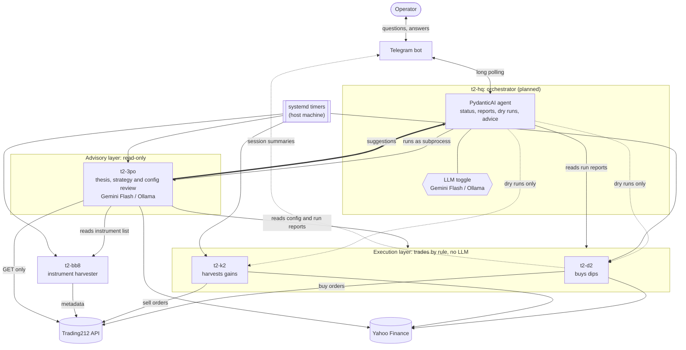
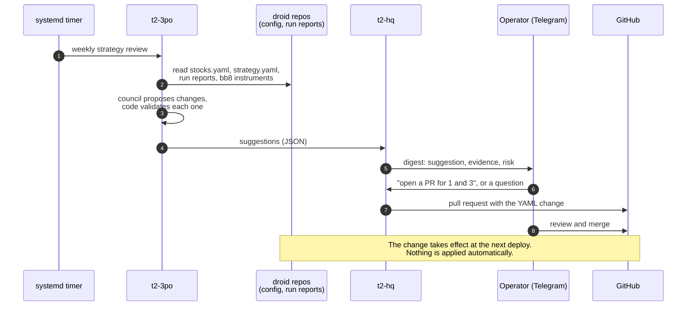
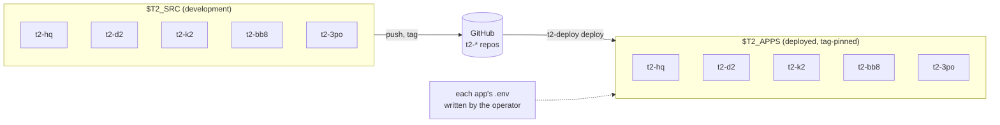

# Architecture

How the T2 droids fit together. Solid boxes exist today; items marked *planned* are described in
[PLAN.md](PLAN.md).

## System overview

Three things to read from this:

- **Orders have one path:** timer → droid → Trading212. The orchestrator and the LLM aren't on it.
- **Advice has one path:** `t2-3po` → `t2-hq` → Telegram → the operator. Nothing changes until
  the operator acts.
- **The timers don't depend on the orchestrator.** If `t2-hq` or the LLM is down, trading continues.

## The advice loop

How a suggestion such as "move RIO from `mild` to `moderate`" or "add a new holding" travels.

## Who may do what

| Component | Trading212 | Writes to | LLM | Schedule |
|---|---|---|---|---|
| `t2-d2` | portfolio, place buys | its own logs and reports | none | one timer per trading session, weekdays |
| `t2-k2` | portfolio, place and cancel its own sells | its own reports | none | weekly |
| `t2-bb8` | instrument metadata, at most one harvest per 20 hours | its data folder (local only, not in git) | none | weekly |
| `t2-3po` | GET only | its reports and suggestions | Gemini Flash (free tier) or Ollama | weekly |
| `t2-hq` | none | pull requests, Telegram, its own state | Gemini Flash or Ollama | always on |

## Where things live

Deployed apps sit side by side, so `t2-3po` reads `../t2-d2/config/` and `../t2-k2/config/`: the
configuration that is actually running, not a development branch.
